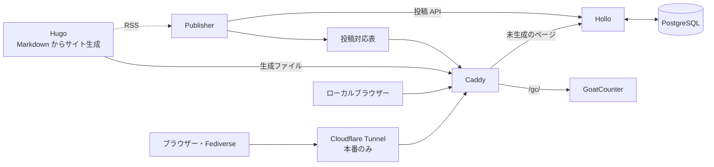

# JJ1GUJのブログ

Hugo と Hollo を Docker Compose で動かす、Fediverse 連携ブログです。記事は Markdown で管理し、公開するとブログのアカウントから Fediverse に投稿します。

## セットアップと使い方

- [開発環境のセットアップ手順](docs/development-setup.md)
- [本番環境のセットアップ手順](docs/production-setup.md)
- [記事の作成](docs/writing-posts.md)
- [記事の自動投稿と OAuth 設定](publisher/README.md)
- [ローカルの Misskey との連合確認](docs/local-federation.md)

## 構成

