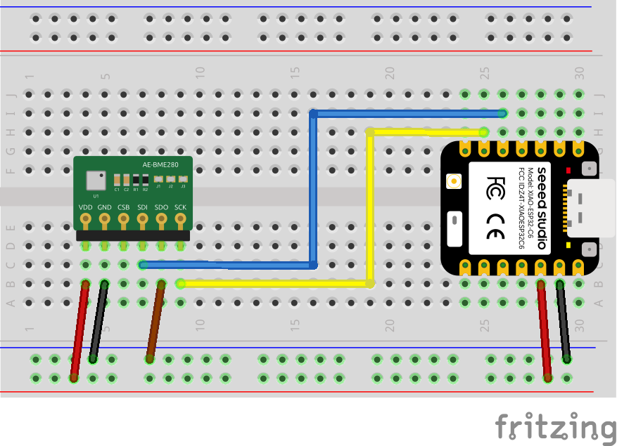
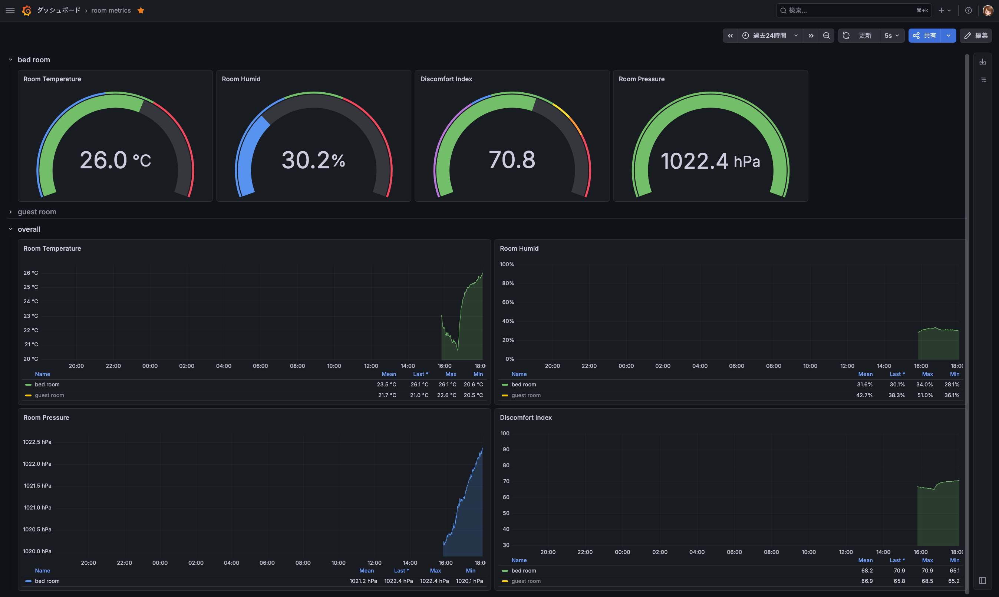

+++
date = '2026-11-07T08:45:04Z'
draft = false
title = 'BME280をXiao ESP32C6で使う方法'
summary = 'BME280をXiao ESP32C6に接続して気温・湿度・気圧を取得する方法を紹介します'
tags = ['IoT', 'プログラミング', 'ESP32']
+++

今までRaspberry Pi 3A+にBME280をつなげて寝室の気温・湿度・気圧を測定していた[^1]が、足を引っかけて壊してしまったので足を引っかけないように小型化することにした。
その際にBME280搭載の温湿度センサをXiao ESP32C6から使えるようにする方法を備忘録として残しておく。

## 使用部品

使用した部品は以下の通り。

* [BME280使用 温湿度・気圧センサーモジュールキット](https://akizukidenshi.com/catalog/g/g109421/)
    * 今回I²Cで使うのでJ1~J3ピンを半田でジャンパしておく
* [Seeed Studio XIAO ESP32C6](https://wiki.seeedstudio.com/ja/xiao_esp32c6_getting_started/)
* ブレッドボード
* ピンヘッダ
* ジャンパ線

## 配線図

配線図は以下の通り



最終的にXIAO ESP32C6のUSB Type-CポートにUSB ACアダプターを挿してコンセント経由で常時給電させた。
このときに使用した追加の部品は以下の通り。
* [USB Type-C オス to USB Type-A オス変換アダプタ](https://amzn.asia/d/0eZG36yB)
* [オーディオ用AC充電器](https://www.yodobashi.com/product-detail/100000001003363957/)



## コード

コードは以下の通り

```ino
#include <Wire.h>
#include <Adafruit_BME280.h>

Adafruit_BME280 bme;

void setup() {
  Serial.begin(115200);
  Wire.begin(22, 23);
  if (!bme.begin(0x76, &Wire)) {
    Serial.println("BME280 is not found!!");
    while(1) delay(10);
  }
}

void loop() {
  float temp = bme.readTemperature();
  float hum = bme.readHumidity();
  float press = bme.readPressure() / 100.0;
  Serial.printf("%.2f C, %.2f %%, %.2f hPa\n", temp, hum, press);
  delay(2000);
}
```

最終的にこのようにWiFi機能と組みあせて気温・湿度・気圧をJSONで返すWebサーバーを実装した。

https://github.com/jj1guj/room_metrics_prometheus/blob/master/server/bme280_server/bme280_server.ino

これを一定時間ごとにfetchしてPrometheusに送信するスクリプトを書いてGrafanaで表示できるようにしている。

https://github.com/jj1guj/room_metrics_prometheus/blob/master/client/main.py



## 感想

久しぶりにはんだ付けをしたらめちゃくちゃ下手になってて泣いた。
定期的にはんだ付けをするべき

ライブラリを使うと時短になってとてもよい。

[^1]: しかもGrafanaをデプロイしているサーバーからリモートGPIOを叩いて取得するとかいう訳のわからない方法をとっていて本当にめちゃくちゃでメンテナンス性最悪だった
