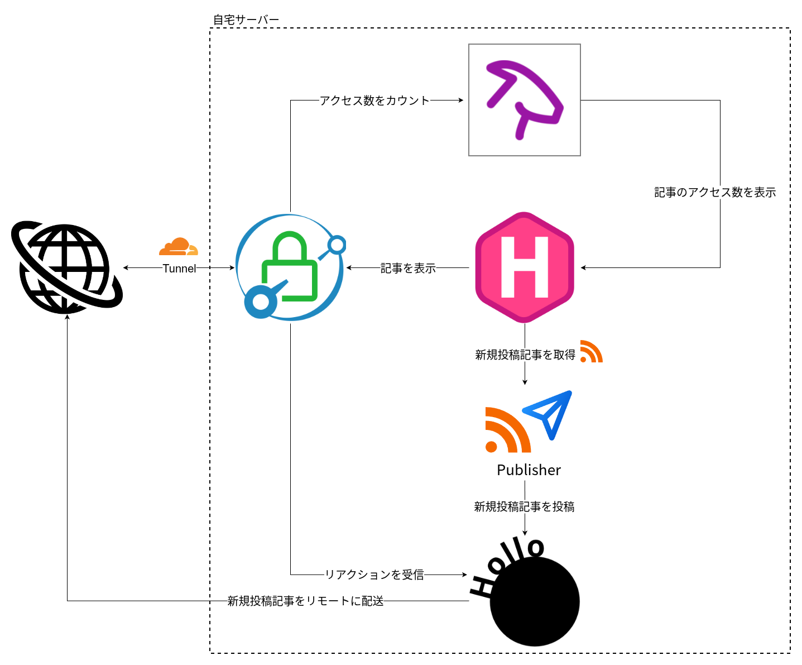

+++
date = '2026-11-02T08:29:37Z'
draft = true
title = 'JJ1GUJのブログの紹介'
tags =['プログラミング']
summary = 'このブログの構成を紹介します'
+++

今回は備忘録としてこのブログについての解説記事を書いていきます。

## きっかけ

自宅サーバーでMisskeyを始めたり他にも様々なWebアプリをホスティングしていく中で、
次第に外部サービスにデータを預けたくないなと思い始めたのがきっかけです。[^1]  
特にZennがで始めたあたりでこのまま何も考えずにQiitaからZennに乗り換えたら一生自前のブログを作らないだろうなぁと思いがあり、プラットフォームを乗り換えるくらいなら自前でホスティングしようという思いが強くありました。
また、MisskeyでFediverseの世界を楽しんでいたこともあり、自前でホスティングするのであれば自分のブログもFediverseに接続したいと思っていました。
そして普段Misskey経由でFediverseの世界を楽しんでいたため、自分のブログもFediverseに接続したいという思いを強く持っていました。  

## 開発の流れ

開発は以下の流れで行いました。

1. 要件定義・技術選定
    * Claudeと壁打ちをして方針を固める
2. 実装・動作確認
    * 実装はGitHub Copilotに丸投げ、人間は動作確認をしてフィードバックをする
3. デプロイ

## 要件

Claudeと壁打ち・技術選定をする中で決めた要件は次の通りです

### docker composeで動かすようにする

Misskey開発や業務でメンテナンスの大変さを体感していたため、メンテナンス性を意識する上でなるべく自前のプログラムは減らしたいという思いがありました。
そのため、なるべく既存のOSSの公開されているイメージを活用し、コマンドを1回叩くだけで開発/本番環境が立ち上がるようにすることを要件に加えました。
これの副次的効果として開発・運用時にホストの環境を汚さず、環境構築の手間を大幅に省くことができました。

### 記事ごとにディレクトリを作れるようにする

手元で記事を作り、管理していく上で1番起こると困ることがそれぞれのメディアデータがどの記事に紐付いているかわからなくなることだと思っています。
そのため、記事とメディアデータで保存するディレクトリが違ったりそれぞれのディレクトリで記事ごとにディレクトリを掘れない構成は避けたいと考えました。
また、記事とメディアデータの保存先が分かれていると探す手間が二重に増えることが考えられたため、これも避けたいと考えました。
以上を踏まえると記事ごとにディレクトリを作成することができ、そこに記事とメディアデータを一緒に保存する方式が最も管理が楽なのではないかと考え、要件に加えました。

### 記事はMarkdownで書けるようにする

軽いメモを取るときでもMarkdownで書いてしまうくらいMarkdownに飼い慣らされてしまったのでこれは必須だと考えていました。
直近で自分のHPもMarkdownで書けるようにしたらものすごく快適になったからというのもあります。

### 記事はFediverseにも配信する

Fediverse上のメジャーなプラットフォームであるMastodonやMisskeyはどちらも(マイクロ/ミニ)ブログサービスを提供するためのプラットフォーム基盤と謳っています。

[Mastodon](https://github.com/mastodon/mastodon)
> Your self-hosted, globally interconnected microblogging community

[Misskey](https://misskey-hub.net/ja/docs/about-misskey/)
> Misskeyはオープンソースの分散型マイクロブログプラットフォームプロジェクトです。

加えて[分散型SNSユーザー有志のホームページ](https://fediverse.pcgf.io)では以下のように接続できるプラットフォームの例としてマイクロブログ・ブログを最初に挙げています。
> マイクロブログ、ブログ、フォトブログ、ビデオホスティングなどの多様なプラットフォームが接続されています。

であるならばブログをFediverseに配信するのは当然でしょう。

### 記事に対するFediverse上での反応(いいね・ブースト/リノート・リアクション・リプライ・引用)はすべて記事上から見れるようにする

自分がなぜここまでMisskeyにハマっているのかを考えたときに真っ先に浮かんだのがいろんな人から多様なリアクションを受け取れることでした。
そのため、Fediverseにブログ記事を配信する際にこの楽しみが失われてしまっては勿体ないと考え、要件に加えました。
記事に反応がたくさんついているとちゃんと読まれているんだなと感じ、承認欲求が満たされて精神衛生上とてもよいです。

## 技術選定

### WordPress+ActivityPubプラグイン
この要件を満たすことができるOSSがないかClaudeに聞いたところ、WordPress+ActivityPubプラグインをおすすめされました。
しかし[php2shell](https://ja.wikipedia.org/wiki/PHP2Shell)でPHPを使っているサービスが軒並みメンテナンスに入って大変なことになっているのを見ていたこと、[PHPは脆弱性の数でアピールしている](https://youtu.be/vmH9-a0BhTY?t=317)ことから自宅でホスティングしてメンテナンスしていくのはかなりきついだろうと思い採用を見送りました。

### WriteFreely

つぎにおすすめされたのがWriteFreelyでした。

https://writefreely.org

これひとつでFediverseとの連携が可能でかなり魅力的に思えたのですが以下の点から採用を見送りました。
* [いいね以外のリアクションを扱えない](https://github.com/writefreely/writefreely/blob/5d1bc057e86aafb6888bf301376b46ea5e0620e7/activitypub.go#L399-L581)
    * ブーストがWriteFreelyに通知されないためブースト数を表示できない
* 公式のDockerイメージが存在しない

### Hugo+GoToSocial+GoatCounter

次におすすめされたのがHugo+GoToSocial+GoatCounterの構成でした。

https://gohugo.io

https://gotosocial.org

https://www.goatcounter.com

これは実際にClaudeに実装させてローカルでの動作環境を試してみました。
しかし試しているうちにブログ用のURLとFediverse用のURLを同じにするためにはCaddyでどのパスをHugoとGoToSocialのどちらに振り分けるかを細かく制御しないといけないことから採用を見送りました。

### Madblog

これを踏まえてブログとFediverseサーバーが一体化したOSSを使った方がいいのではとなり、Claudeに調査させたところMadblogが見つかりました。

https://github.com/blacklight/madblog

実際に使って試してみたのですが、以下の点から採用を見送りました。
* 記事とメディアデータの保存先のディレクトリが異なる
    * メディアデータについては/img直下にサブディレクトリを作成できない
* x64向けイメージしか配布していない
* 数式を表示できるようにするためにフルでイメージをビルドするとイメージサイズが2GBを超える
    > Includes all plugins - including LaTeX and Mermaid; > 2 GB in size.
* バックエンドがPython
    * 個人的にバックエンドがPythonのWebアプリはなるべく動かしたくないという思いがあった(個人の感想)

## 最終的な構成

最終的にHugoでの執筆体験が非常によかったため、以下のようなHugo+Hollo+GoatCounterの構成にしました。

https://docs.hollo.social/

Hugo+GoToSocial+GoatCounterの構成とかなり似ていますが、GoToSocialよりFediverse用のURLとブログのURLを同じにするのがより簡単であったこと、リアクションの表示を認証なしにできることからHolloを採用しました。

それぞれの役割はこのようになっています。
* Caddy: インターネットからやってきたリクエストをHugo・Hollo・GoatCounterに振り分ける
* Hugo: ブログ本体
* Publisher: Hugoから配信されたRSSを読み取り、新しく記事が投稿されたらHolloに通知する
* Hollo: 新規投稿記事のFediverseへの自動投稿とリアクションの受信を行う
* GoatCounter: ブログ記事の閲覧数を取得する

Hugoからはページを表示するときにHolloとGoatCounterのAPIを叩き、リアクション・閲覧数を取得し、記事上に表示するようにしています。

## 工夫した点

工夫した点としてローカルでしか公開されない管理用ポートがあります。

Holloは初回起動直後にページにアクセスし、アカウントを作成する必要があります。
しかしこれをCloudflare Tunnelで公開した状態でその公開URLにアクセスし、アカウント作成を行おうとすると悪意のある第三者が先にアクセスしてアカウントを作成してしまう懸念がありました。
そのため、Holloの管理画面には外部には公開しない管理用ポートからしかアクセスできないようにすることでこの問題を解決しました。
普段Holloの管理画面に入ることはほとんどないのでこの機能により安心感は増したのですが、いざ管理画面に入りたくなったときに管理用ポートを開くのが面倒でもうすこしいい方法がなかったかなと思っています。

## 今後の展望

今後以下の機能・ページを実装したいと考えています。

* aboutページの追加
* フォロワー一覧を表示できるように
* 各記事から前のエントリと次のエントリに飛べるように

Fediverseの連携機能は現状満足していますが見た目の作り込みはまだ甘いと感じています。
そのため、フロントエンドの強化を今後頑張る予定です。

## 最後に

今回作成したブログシステムはGitHub上で公開しているのでぜひ使ってみてください。

<!-- ソースコード公開後にリポジトリへのリンクを貼る -->

[^1]: といいながらGoogleに年間1.5万円くらい払ってデータを全部預けるGoogleの犬をやっている
