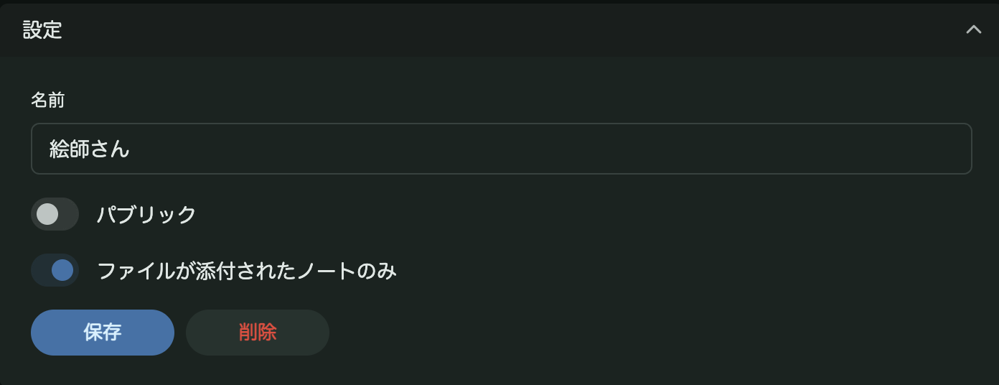
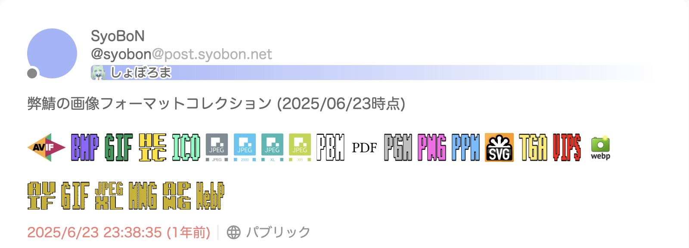
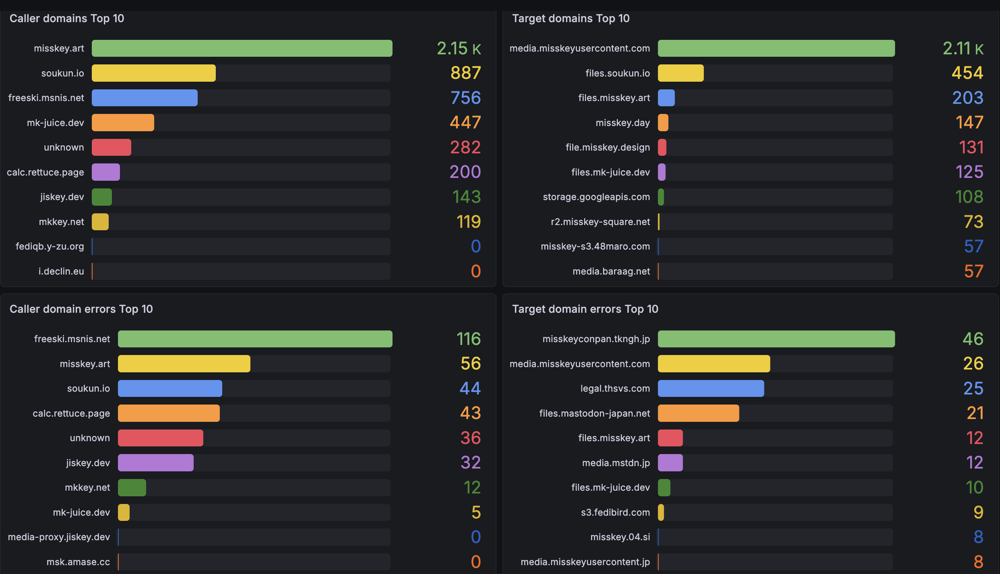
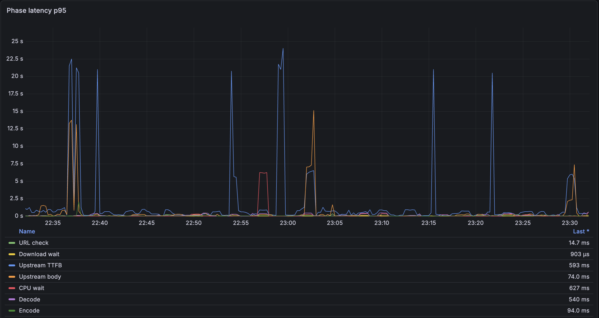

+++
date = '2026-11-03T13:19:50Z'
draft = true
title = '2026年のjiskey'
tags = ['Misskey', '自宅サーバー']
summary = '2026年のjiskeyを振り返りと来年の展望'
+++

<!-- 
TODO:
[] 前回記事と次回記事の予告を埋める
[] サーバー運営で稼働時間のダウンタイムの一覧のスクショを撮って貼る 
-->

これは[Fediverse Advent Calendar 2026](https://adventar.org/calendars/12848) 3日目の記事です。

昨日は...さんの[...](url)でした。明日は押尾げむさんの「長めの人生からの眺め」です。

この記事ではjiskeyの軽い紹介をした後、2026年のjiskeyの振り返りと来年の展望について書いていきます。

## jiskeyとは

jiskeyは2023年7月からJJ1GUJが運営しているMisskeyサーバーです[^1]。
Raspberry Pi上でCloudflare Tunnelを活用しホスティングをしています。
初期はRaspberry Pi 4B 4GBで動かしており[^2]、2024年3月からRaspberry Pi 5B 8GBで動かし今に至ります[^3]。

2025年9月からはvanillaのMisskeyからforkし、独自の改造を加えたforkソフトウェア、jiskeyの開発を開始しました。
モバイル環境でウィジェットが右から出るようになっていたり[^4]、アンケートの選択肢を最大100択にできるようになっていたりととにかくJJ1GUJがほしいと思った機能を入れるようにしています。
また、独自に見つけた不具合は積極的にupstreamにPRを送るようにしており、upstreamとの交流の活発化を図っています。
加えてリリースごとにupstreamの追従を行うようにしており、スクリプトにより一部作業の自動化を行い、upstream追従の省力化にも取り組んでいます。

https://github.com/jj1guj/jiskey

https://github.com/jj1guj/jiskey/blob/jiskey_develop/jiskey_update.sh

ここからは2026年のjiskeyについてサーバー運営・ソフトウェア開発の両方を振り返っていきます

## 2026年のjiskeyサーバー運営

### 稼働率

今年は大きな不具合に見舞われることなく、高い稼働率を達成することができました。
日時点で2026年の総ダウンタイムは55分であり、稼働率は約99.9%でした。
Raspberry Piによるホスティングでこの稼働率はかなりすごいのではないかと思っています。
最近ルーターの調子が悪く、頻繁に再起動することでダウンタイムが発生しているので来年以降も引き続き安定稼働を達成するためにはルーターをどうするかは避けて通れない問題です。

### ユーザー数

今年はユーザー数が5人増えました(bot含む)。
サーバー開設当初からユーザー登録は私から招待コードをもらわないとできないようになっており、基本的にはエンカした人に招待コードを渡すようにしています。
来年は積極的にエンカをしてたくさん招待コードを渡したいです。
また、過去にエンカした方でjiskeyの招待コードをもらっていない人、招待コードの期限切れで登録できない人は連絡をください。新しい招待コードをお渡しします！

今年は私が住む名古屋市からのお知らせを自動で投稿するbotを開発しました。
jiskey以外のリモートのユーザーのみなさんにもフォローしていただいており、励みになっています！

https://jiskey.dev/@nagoya_city_info_bot

## 2026年のjiskeyソフトウェア開発

### jiskey

今年jiskeyに加えた独自の修正は以下の通りです。

https://github.com/jj1guj/jiskey/issues?q=is%3Aissue+state%3Amerged+sort%3Acreated-asc+merged%3A2026-01-01..2026-12-31+NOT+%22Update+Misskey%22+NOT+%22jiskey+2026%22+in%3Atitle

この中で主要な修正について解説していきます。

#### Docker hubでのjiskey Dockerイメージの公開

今年の4月頃までアップデートのたびにjiskeyを動かしているマシン上でDockerイメージをビルドし直していたのですが、時間がかかること、マシンリソースをかなり消費することからこの方法を見直し、jiskeyのjiskey_developブランチ又はmasterブランチに修正がマージされるたびに自動でDockerイメージをビルド・タグ打ちし、Docker HubにpushするCIを実装しました。
これによりjiskeyのアップデート時にはDocker Hubへのpushが完了するまで待機し、完了したらjiskeyのサーバー上でイメージをpull・再起動するように運用が変わり、省力化を達成しました。
CIでのDockerイメージのビルドではghcr.ioに蓄積させているビルドキャッシュを活用し高速化をしています。
jiskeyのDockerイメージはこちらで公開しているのでぜひ使ってみてください！

https://hub.docker.com/r/jj1guj/jiskey/tags

https://github.com/jj1guj/jiskey/pull/94

#### ユーザーリストのタイムラインでファイルが添付されているノートのみ表示する

Misskeyではアンテナ機能においてファイルが添付されているノートのみタイムラインに表示できるようになっていますが、ユーザーリストではそうなっていませんでした。
私はタイムライン上の絵師さんを集めたリストを作成しているのですが、このタイムラインの使用では絵師さんの絵を追いづらくなっていました。
そこで、アンテナ機能と同様にファイルが添付されているノートのみを表示できるオプションを追加しました。
以下の画像のようにユーザーリストのタイムライン設定画面にある「ファイルが添付されたノートのみ」スイッチを切り替えることでこの設定を有効化できるようになっています。

https://github.com/jj1guj/jiskey/pull/81

#### プライバシーの強化

Misskeyには自分のノートを表示するのにログインを必須にする機能があります。
しかし、これを有効にしても自分のリノートやリアクションは表示されてしまう問題がありました。
そこで、これを解決するために、既存の「コンテンツの表示にログインを必須にする」オプションを有効にしたらリノートも自動で非表示になるように修正しました。
加えて、新しく「リアクションの表示にログインを必須にする」オプションを追加し、これを有効にすると以下のように未ログイン状態でリアクションの一覧が表示されないようになりました。
しかし連合先のサーバーからはこれらは見れてしまうことには注意が必要です。

https://github.com/jj1guj/jiskey/pull/199

https://github.com/jj1guj/jiskey/pull/200

#### iOSのPWAでの不具合修正

私は普段iOSのPWAでMisskeyを触っているのですが、バックグラウンドから復帰する際にエラー画面が出る、タイムラインのアイコンが巨大になるなどの不具合が出ていました。
そこで

https://github.com/jj1guj/jiskey/pull/138

#### ネイティブ画像ビューワーの不具合修正

Misskeyでは2026.7.0から画像ビューワーが刷新されました。
これに伴いクライアントで「添付画像のサムネイルをオリジナル画像にする」オプションを有効にしていたときにサムネイル画像をタップしてから画像ビューワーが立ち上がるまでにラグが発生しているのを見つけました。
これの原因を解析し、修正を行いました。

https://github.com/jj1guj/jiskey/pull/163

こちらはupstreamにもPRを出したところマージされ、人生初のMisskeyへのコントリビュートとなりました。

https://github.com/misskey-dev/misskey/pull/17703

### メディアプロキシ

jiskeyでは[media-proxy-rs](https://github.com/cheripia-dev/media-proxy-rs)をforkし、独自の改変を加えたメディアプロキシを運用しています。

https://media-proxy.jiskey.dev

https://github.com/jj1guj/media-proxy-rs

今年はパフォーマンス改善に加え、多様な画像フォーマットへの対応を行いました。

これにより、[しょぼろま](https://post.syobon.net/)で対応している画像フォーマットコレクションをすべて表示できるようになりました。

https://post.syobon.net/objects/d1a070b6-4c3e-4bf6-a261-87c090c9e332

これと宣伝のおかげもあり、今年から1万超えのユーザーを抱える[misskey.art](https://misskey.art)をはじめとした多くのサーバーで採用していただくことになりました。
これに伴いリソースの使用状況やサーバーごとのリクエスト数を監視できるようにGrafanaでの監視基盤の構築を行いました。

これにより何が原因でリクエストが遅くなっているのか、どのサーバーへのリクエストでエラーがどのくらい出ているのかなどがわかりやすくなり、より的確な改善策を採用しやすくなりました。
現在はMisskey.ioのメディアサーバーへのリクエストが集中すると429がかかってしまう問題を回避する改善を本番環境で実際に動かしながら試行錯誤しているところです。

なお、これだけ多くの方に使っていただいているにもかかわらずリソースはかなり余っているので気になる方がいたらぜひ使ってみてください！

### sensitive-detector

2026.7.0でセンシティブメディアの判定(NSFW検出)が本体に内蔵された nsfwjs による推論から、外部サービスsensitive-detectorへのHTTP呼び出し方式に変更されました。

https://github.com/misskey-dev/sensitive-detector

jiskeyではもともとこの機能を使用していたため、これに追従して使用したところ、推論にはTF.jsを使っていたためx64環境でしか動作しないことが判明しました。
そこで、ONNX Runtimeでの推論に移行させ、arm64環境でも動作する修正を行いました。
この修正により、推論速度が平均20%高速化、CPU使用率を59%ｍメモリ使用量を33%削減しました。
この結果を基にupstreamにPRを出したところマージされ、リリースノートに名前を記載していただきました。

https://github.com/misskey-dev/sensitive-detector/pull/11

https://github.com/misskey-dev/sensitive-detector/releases/tag/v0.0.2

## 来年のjiskey

### サーバー運営

来年はサーバーマシンのOS移行という大きなイベントを予定しています。
現在サーバー機にはRaspberry Pi OS Lite (bookworm)を採用しており、これは2026年7月で通常サポートが終了しLTSサポートに移行しています[^5]。
そのため、OSのアップデートを考えているのですがRaspberry Pi OSはOSアップグレード専用のコマンドは用意されておらず、クリーンインストールが推奨されています。
https://www.raspberrypi.com/documentation/computers/os.html#os-installation
> If you’re running a previous version of Raspberry Pi OS and want to use the latest major version, don’t perform an in-place update (updating the current system without reinstalling). Instead, start again by installing a new image of Raspberry Pi OS. 

今後数年おきにOSアップグレードを続け、運用し続けていく上でこの現状は持続可能性に欠ける、OSの乗り換えを検討しています。
現時点ではUbuntu Serverへの乗り換えが最有力[^6]であり、移行の際のダウンタイムをなるべく短くできないか調査しています。
来年の間に検証を済ませ、OS移行を完了させたいと思っています。

### ソフトウェア開発

現時点で特にこれといった独自機能の開発は考えていないです。
既存のissueを消化できたらなぁくらいに考えています。

メディアプロキシについてはまだ改善の余地があるので引き続き取り組んでいく予定です。

## 最後に

今年もjiskey内外で皆様には大変お世話になりました。
来年以降も引き続き安定稼働及び改善に努めて参りますので何卒よろしくお願いします。

[^1]: 昔は「サーバー」ではなく「インスタンス」と呼んでいたんじゃよ(Misskey老人)  
[^2]: 実はサーバーを解説してから3日くらいはGCPで動かしていた(jiskey㊙豆知識)  
[^3]: 引っ越しの輸送時の衝撃で1度壊れたので今のマシンはRaspberry Pi 5B 8GBになってから2代目だったりする(jiskey㊙豆知識2)  
[^4]: 昔はvanillaのMisskeyも右から出るようになっていたのに左から出るようになっちゃった、、、
[^5]: https://www.debian.org/News/2026/20260712.en.html
[^6]: と言いつつUbuntuくんはLinuxカーネルのアップデートが遅いのでほかにもっといいディストリビューションがないか迷い中
