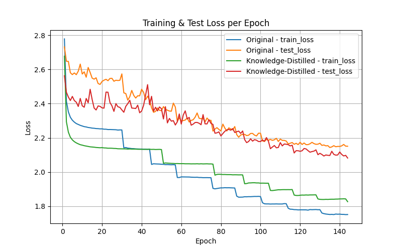
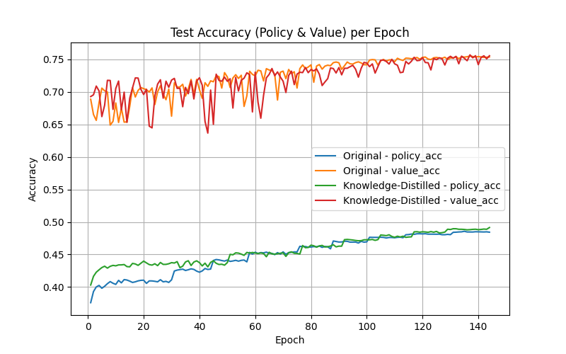

+++
date = '2026-11-17T14:32:00Z'
draft = false
title = '将棋AIで知識蒸留を試す'
summary = '将棋AIで知識蒸留を行い、LLMにネットワークの重みの構造に変化があるか解析させてみた'
tags = ['プログラミング', '将棋AI', '機械学習', 'LLM']
+++

https://blog.jj1guj.net/posts/try_weight_space_programming_on_shogi_ai/ の続編

## はじめに

前回将棋AIでWeight-Space Programmingを試したところうまくいかなかったので知識蒸留を行い、通常学習モデルと比べどのくらい強くなるのかを試してみた。
また、知識蒸留モデルと通常学習モデルでネットワークの重みにどのような違いが出るのか気になったため、LLMにネットワークの重みを読み込ませ、どのような違いがあるのか解析させた。

## 知識蒸留とは

知識蒸留はGeoffrey Hintonらによって導入された機械学習手法である[^1]。
大規模モデルの出力や内部表現を小規模モデルに教えることで、小規模モデルを一から学習させるよりも効率よく、高い精度で学習できる手法である。
将棋AIでも主にDL系モデルからNNUE系モデルへの知識蒸留が盛んに使われており、2026年に開催された世界コンピュータ将棋選手権での独創賞・CSA貢献賞が知識蒸留であったことも記憶に新しい[^2]。

## 学習実験

モデルの生成を兼ねて学習実験を行い、policy・valueのaccuracy(正解率)の比較を行った。

学習データにはDL将棋本付属のデータを使用した。
知識蒸留時のみpolicyとvalueを大規模モデルであるponkotsu第36回世界コンピュータ将棋選手権バージョン(ResNet35x512)の出力に置き換えた。
このモデルは以下で配布している。

https://jj1guj.booth.pm/items/8321632

学習条件
{.table-caption}

|項目|通常学習の設定値|知識蒸留の設定値|
|:--:|:--|:--|
|epoch数|144|同左|
|最適化関数|SGD|同左|
|スケジューラ|`ReduceLROnPlateau(eps=1e-20, factor=0.5)`|同左|
|初期学習率|0.2|同左|
|最終学習率|7.8125e-04|1.5625e-03|
|AMP dtype|float16|同左|

学習曲線及びaccuracyの推移を以下の図に示す。

DL将棋本付属のテストデータに対するpolicy・valueのaccuracyを以下の表に示す。

テストデータに対するaccuracy
{.table-caption}

|手法|Policy Accuracy (%)|Value Accuracy (%)|
|:--:|:--:|:--:|
|通常学習|48.8|75.7|
|知識蒸留|**49.5**|**76.1**|

以上のように知識蒸留モデルの方が最終学習率が高いにもかかわらずtest lossは低く、accuracyは高くなった。
これは教師ラベルを大規模モデルの出力に置き換えたことで、その表現力が高まったためと考えられる。
元の学習データのpolicyは指した手のみ1、指した手以外の手は0というようなone-hot表現となっている。
しかし知識蒸留時の教師ラベルには、指した手以外の手にも着手確率が記録されているため、実際に指されていない手同士でどちらの方がより着手確率が高いかが知識として与えられるようになっている。
これは、valueについても同じことが言える。
元の学習データのvalueは与えられた局面において手前側のプレイヤーが勝ったら1、負けたら0という二値ラベルになっている。
これが知識蒸留時には手前側のプレイヤー視点の勝率となるため同じ勝ちの局面でもどちらの方がより勝ちに近いかが知識として与えられるようになっている。

## 対局実験

知識蒸留モデルと通常学習モデルで強さに差があるか確認するための対局実験を行った。

思考エンジンにはやねうら王(`YANEURAOU_ENGINE_DEEP_TENSOR_RT_UBUNTU`)を使用し、探索パラメータはデフォルト値を使用した。
[やねうら王互角局面集2025](https://github.com/yaneurao/YaneuraOu/releases/tag/BalancedPositions2025)を初期局面とし、1分2秒フィッシャーで200局対局した結果を以下に示す。
なお勝率において引き分けは0.5勝0.5敗として計算している。

知識蒸留モデルの勝敗
{.table-caption}

|勝敗|勝率(%)|
|:--:|:--:|
|135勝44敗21分|72.8|

レート差は170.6±50.9(95%信頼区間)となり、知識蒸留により有意に強くなることがわかった。
ちなみに先手勝率は71.5%(66勝23敗11分)、後手勝率は74.0%(69勝21敗10分)だった。

## LLMによる解析

ここではGitHub Copilotで使用するLLMをClaude Opus5.5に固定して解析を行った。

ネットワークの重みはONNX形式で渡した。
ただしGitHub CopilotのClaude Opus5.5だとONNXファイルを直接読み込むことができなかったため、プロンプトでONNXファイルのパスを与え、Python経由で読み込ませた。
機械学習ライブラリやcshogiなどのツール及び学習データ・棋譜はモデルの学習以外の用途に限って使用を認めた。

LLMはブロックを1つずつ外して推論し出力の変化を見る実験と、ネットワークの重みの読み取りの2つの方法で解析していた。
なお、あくまでLLMによる解析であり検証した結果ではないため本当に正しいかは不明である。

### ResNetブロック

通常学習モデルにおける各ブロックの役割は以下の通りだった。

通常学習モデルにおける各ブロックの役割
{.table-caption}

| ブロック | 役割 | Policyへの貢献度 | Valueへの貢献度 |
|:--:|:--|:--:|:--:|
| 1 | 自玉の位置と利きを整理し、歩打ちなどの駒打ちの候補手を作る | 中 | 中 |
| 2 | 利きの情報を整理し、歩打ちなどの駒打ちの候補手を補う | 小 | 中 |
| 3 | 両玉の位置をもとに、銀打ちなどの駒打ちの候補手を作る | 小 | 中 |
| 4 | 両玉の周りの駒と利きの関係を作る | 小 | 中 |
| 5 | 敵の利きと両玉の位置をもとに、桂打ち・銀打ち・角打ちの候補手を作る | 小 | 中 |
| 6 | 駒打ちの候補手を作る | 小 | 中 |
| 7 | 敵玉の周りの利きを広げ、駒打ちの候補手を作る | 小 | 小 |
| 8 | 敵玉を攻める駒打ちの候補手を作る | 小 | 小 |
| 9 | 最終手前の調整として銀打ちの候補手を作る | 中 | 中 |
| 10 | 最終組み立てとして、盤上の駒の移動(特に前に進む手)を作り、valueの大部分も作る | 大 | 大 |

各ブロックごとのpolicyにおける大まかな役割は知識蒸留モデルでも変わらなかった。
ただし以下の3点が異なっていた。
* valueをブロック10に加え入力に近いブロック1・2と出力に近いブロック9で分担するようになった
    * 通常学習モデルではブロック10のみ貢献度が「大」だった
    * 知識蒸留モデルではブロック1・2・9も「大」だった
* ブロック1で読む利きが変化した
    * 通常学習モデルでは敵の大駒の利きを中心に読んでいた
    * 知識蒸留モデルでは自玉と敵玉の利きを中心に読むようになった
* 歩打ちの候補手を作るブロックが変化した
    * 通常学習モデルではブロック1・6に集中しブロック2で補っていた
    * 知識蒸留モデルではブロック2〜5に分散していた

また、最後のResNetブロック(ブロック10)の出力(9×9×154)には、通常学習モデルと知識蒸留モデルで以下の違いが見られた。

* policyの組み立てに使うチャンネルが入れ替わり、主要なチャンネルが増えた
    * policyに大きく効くチャンネル数が3から7に増えた
* 入玉と敵陣の制圧に反応するチャンネルができた
    * policyとvalueの両方に効いていた
* valueの判断材料が分散した
    * 通常学習モデルでは、自分の利きが敵より多いかを表すチャンネルにvalueのほとんどを任せていた
    * 知識蒸留モデルでは、このチャンネルへの依存が半分以下になり、以下のチャンネルの比重が増えた
        * 不利な要素を表すチャンネル(自玉が攻められているか、駒損しているか)
        * 局面の進み具合を表すチャンネル

### policy head・value head

policy headには大きな違いが見られなかった。
一方でvalue headには以下の違いが見られた。

* 隠れ層で実質的に使われていないユニットが増えた
    * 重みがすべてほぼ0になっているユニット数が3から50に増えた
        * 実際これらのユニットを取り除いて隠れ層のユニット数を154から104にしても、出力は浮動小数点の誤差の範囲でしか変わらなかった
    * 残りのユニットはより多くの局面で働くようになった

## まとめ

今回は知識蒸留を行いaccuracy・対局での強さ・ネットワークの重みの構造にどのような差が出るかを検証した。
その結果、知識蒸留モデルはテストデータに対するpolicy・valueのaccuracyがいずれも通常学習モデルを上回り、対局実験でも勝率72.8%(レート差170.6±50.9)と有意に強くなった。
これは、one-hot表現や二値ラベルだった教師ラベルを大規模モデルの出力に置き換えたことで、指されていない手同士の優劣や、同じ勝ちの局面の中での勝ちやすさの差も学習できるようになったためと考えられる。

また、LLMによる解析では、policyに関する各ブロックの大まかな役割やpolicy headの構造に大きな違いは見られなかった。
一方でvalueについては、1つのブロックやチャンネルに頼る形から、複数のブロックやチャンネルで分担して判断する形へ変わっていた。
さらにvalue headでは実質的に使われないユニットが増えており、value headを小さくしても同等の出力が得られる可能性がある。
ただし、これらはLLMによる解析結果であり、正しさは検証していない点に注意が必要である。

[^1]: https://arxiv.org/abs/1503.02531
[^2]: https://x.com/nodchip/status/2051677405203636245
